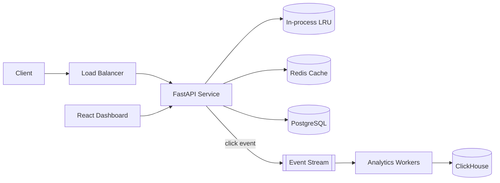

# Snip: High-Throughput URL Shortener with Real-Time Analytics

## Why this project exists

Two or three sentences. Frame it as an engineering problem, not a toy:

- The problem: read-heavy, latency-sensitive, abuse-prone, and needs analytics without slowing the hot path.
- What this repo demonstrates: caching strategy, async pipelines, security, observability, and operability at scale.


## Features

- **Fast redirects**: layered cache (in-process LRU → Redis → Postgres), stampede protection, negative caching
- **Async analytics**: click events streamed via <Redis Streams/SQS/Kafka>, batch-loaded into <ClickHouse/Postgres>
- **Multi-tenancy**: tenant isolation enforced at the repository layer, with tests
- **Security**: JWT with refresh rotation, hashed API keys, SSRF protection, malicious-URL checks, rate limiting
- **Observability**: structured logs, OpenTelemetry traces, Prometheus metrics, Grafana dashboards, SLOs
- **Resilience**: timeouts, retries with backoff, circuit breakers, graceful degradation
- **Ops-ready**: Docker, Terraform, CI/CD, zero-downtime deploys, runbook

---

## Architecture



### Request flow: redirect (hot path)
1. Check in-process cache → Redis → Postgres (cache-aside)
2. Return `302` immediately
3. Emit click event asynchronously (never blocks the response)

### Request flow: create link
Short description, including ID generation and idempotency.

Full design doc: [docs/architecture.md](docs/architecture.md)

### Key design decisions

| Decision | Choice | Alternatives considered | ADR |
|---|---|---|---|
| ID generation | Base62 of distributed ID | Random hash, MD5 truncation | [ADR-001](docs/adr/001-id-generation.md) |
| Cache strategy | Layered cache-aside | Write-through | [ADR-002](docs/adr/002-caching.md) |
| Analytics transport | <choice> | Kafka, direct DB writes | [ADR-003](docs/adr/003-analytics.md) |
| Redirect status | 302 | 301 | [ADR-004](docs/adr/004-redirect-status.md) |

---

## Tech stack

| Layer | Technology |
|---|---|
| API | FastAPI, Uvicorn/Gunicorn, Pydantic v2 |
| Database | PostgreSQL 16, SQLAlchemy 2.0 (async), Alembic |
| Cache / rate limiting | Redis 7 |
| Analytics | <ClickHouse / partitioned Postgres> |
| Frontend | React, TypeScript |
| Infra | Docker, Terraform, AWS (ECS Fargate, RDS, ElastiCache) |
| Observability | OpenTelemetry, Prometheus, Grafana |
| Testing | pytest, testcontainers, k6 |
| CI/CD | GitHub Actions |

---

## Getting started

### Prerequisites
- Python 3.12+, [uv](https://github.com/astral-sh/uv)
- Docker and Docker Compose
- Node 20+ (for the dashboard)

### Run locally

```bash
git clone https://github.com/<you>/snip-url-shortener.git
cd snip-url-shortener
cp .env.example .env
make up          # starts Postgres, Redis, workers, Grafana
make migrate     # runs Alembic migrations
make seed        # optional: loads sample data
make dev         # starts the API with hot reload
```

- API: http://localhost:8000 (docs at `/docs`)
- Dashboard: http://localhost:5173
- Grafana: http://localhost:3000

### Common commands

```bash
make test        # unit + integration tests
make lint        # ruff + mypy
make loadtest    # k6 scenarios
```

---

## API overview

| Method | Endpoint | Description |
|---|---|---|
| `POST` | `/v1/links` | Create a short link (idempotency key supported) |
| `GET` | `/{slug}` | Redirect to the target URL |
| `GET` | `/v1/links/{id}/stats` | Click analytics |
| `DELETE` | `/v1/links/{id}` | Disable a link |

Full interactive docs at `/docs` (OpenAPI).

---

## Performance results

### Methodology
Hardware, region, dataset size, k6 scenario, warm-up, and duration. Make this reproducible: link to `loadtests/`.

### Results

| Scenario | RPS | p50 | p95 | p99 | Error rate |
|---|---|---|---|---|---|
| No cache (Postgres only) | | | | | |
| Redis cache | | | | | |
| Layered cache (LRU + Redis) | | | | | |
| Sync analytics vs async analytics | | | | | |


### Horizontal scaling
Chart showing throughput vs number of replicas.

### Capacity planning
Example: 10M redirects/day ≈ 115 RPS average, ~1–2k RPS at peak. Show instance sizing and monthly cost.

### Chaos / failure tests

| Failure injected | Observed behavior | Recovery |
|---|---|---|
| Redis down | Fallback to Postgres, p99 rises to X ms | Automatic |
| Queue unavailable | Events buffered/dropped with metric, redirects unaffected | Automatic |
| Primary DB failover | | |

---

## Security

- **Authentication/authorization**: JWT (short-lived) + refresh rotation; API keys stored hashed
- **Tenant isolation**: enforced in the repository layer and covered by tests
- **Input validation**: Pydantic, scheme allowlist, SSRF protection, destination checks
- **Abuse prevention**: Redis-based token bucket rate limiting (per key and per IP)
- **Secrets**: AWS Secrets Manager, none committed
- **Supply chain**: `pip-audit`, Dependabot, Trivy image scanning in CI
- **Threat model**: [docs/threat-model.md](docs/threat-model.md)

---

## Observability and SLOs

| SLI | SLO |
|---|---|
| Redirect availability | 99.9% |
| Redirect latency p99 | < <X> ms |
| Analytics freshness | < <N> s |

Dashboards: [docs/img/grafana.png](docs/img/grafana.png) · Runbook: [docs/runbook.md](docs/runbook.md)

---

## Deployment

- Infrastructure as code: [`infra/`](infra/) (Terraform)
- CI/CD pipeline: [`.github/workflows/`](.github/workflows/)
- Deployment strategy: rolling / blue-green, with rollback steps in the runbook
- Cost estimate: ~$<X>/month for the reference deployment

---

## Testing

- **Unit tests**: business logic, with no I/O
- **Integration tests**: real Postgres and Redis via testcontainers
- **Contract/e2e tests**: API behavior and tenant isolation
- **Load tests**: k6 scenarios in `loadtests/`
- Coverage: XX%

---

## Repository structure

```
snip-url-shortener/
├── app/            # API, services, repositories, workers
├── frontend/       # React dashboard
├── infra/          # Terraform, Dockerfiles, compose
├── loadtests/      # k6 scripts and results
├── docs/           # architecture, ADRs, threat model, runbook
└── tests/
```

---

## Trade-offs and what I'd do at 100x scale

Be candid here. This section signals seniority.

- Current limitations (single-region, Redis as a single shared cache, etc.)
- What would change at 10x / 100x: sharding strategy, multi-region, Kafka, CDN/edge redirects
- What I deliberately did *not* build, and why

---

## Roadmap

- [ ] Multi-region reads
- [ ] Edge redirects via CDN workers
- [ ] <Optional: natural-language analytics queries>

## Contributing

Short note on how to run checks, commit conventions, and PR expectations.

## License

MIT, see [LICENSE](LICENSE).

## Author

**Varsha Nagaraja** ·